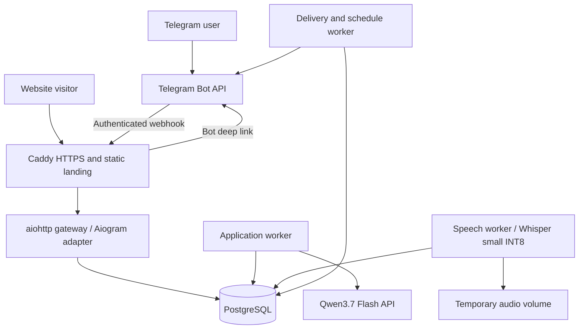

# Pin — DDD Architecture

Date: 2026-10-13. Status: **proposed architecture for review**.

This document turns [the brainstorm brief](PROJECT_BRAINSTORM.md) into concrete technical decisions. The user explicitly requested Domain-Driven Design. The modular-monolith approach and additional technologies below are recommendations, not previously approved implementation choices. This document does not authorize deployment, purchases, or implementation.

## 1. Architectural decision

Build a **Python modular monolith with DDD bounded contexts and ports/adapters**, deployed as separate gateway, application, delivery, and speech-worker processes. Use one PostgreSQL database, with schemas owned by their respective contexts.

Why this fits Pin:

- The first target is 50 daily active users and an operating budget under US$50/month.
- Task scheduling, recurrence, completion, and access rules need explicit domain logic.
- CPU-heavy speech recognition must not block Telegram ingestion or reminder delivery.
- One repository and database reduce deployment and transaction complexity.
- Explicit contracts allow extracting a context or worker later without starting with microservices.

Alternatives considered:

| Approach | Advantages | Costs | Decision |
|---|---|---|---|
| Modular monolith | Clear ownership; local contracts; simple deployment | Boundaries need automated enforcement; shared host is a failure domain | Select for v1 |
| Microservices | Independent service scaling and deployment | Distributed failure handling, more infrastructure, harder local development | Defer |
| Handlers directly using ORM and AI | Quick prototype | Business rules spread across Telegram handlers; unreliable retries and ownership | Reject for the production design |

DDD here means modeling business invariants, aggregate lifecycles, and ownership. It does not mean introducing a framework, a class for every database row, or a service for every context.

## 2. Technology decisions

| Concern | Selected/proposed technology | Role and rationale |
|---|---|---|
| Runtime | Python 3.12 | Conservative initial runtime for the bot and speech ecosystem; verify the full dependency lock on this runtime |
| Bot | Aiogram 3.x | Telegram transport, update models, routers, callbacks, and API client; already selected |
| HTTP gateway | aiohttp | Aiogram's documented integration; receives webhooks and serves internal health routes |
| Domain objects | Standard-library dataclasses, enums, typing.Protocol | Framework-independent aggregates, value objects, and ports |
| Input/output validation | Pydantic 2.x | Validate configuration, transport DTOs, and AI action proposals; does not replace domain invariants |
| Database | PostgreSQL 18 | Application data, durable inbox/outbox, job leases, and usage ledger |
| Persistence | SQLAlchemy 2.0 async ORM/Core | ORM mappings and explicit queries inside infrastructure adapters |
| Driver | Psycopg 3 | PostgreSQL driver with async application and sync migration support |
| Migrations | Alembic | One reviewed migration history for all owned schemas |
| AI model | Qwen3.7 Flash | User-selected model; task interpretation and practical planning support |
| AI provider adapter | OpenRouter initially, through HTTPX | Proposed access route; isolate provider-specific payloads and token accounting |
| Speech | faster-whisper + multilingual Whisper small, CPU INT8 | User-selected recognition model and inference implementation |
| Recurrence | python-dateutil rrule behind a port; zoneinfo + tzdata | Calendar recurrence expansion and IANA time-zone handling |
| Background work | PostgreSQL-backed job ledger | Atomic creation with business mutations; initially no separate broker |
| Telegram formatting | MarkdownV2 renderer | Deterministic templates with escaped user text; no arbitrary model-generated formatting |
| Landing | Static HTML/CSS with minimal JavaScript | Product explanation and Telegram deep links; no frontend application state required |
| Reverse proxy | Caddy | HTTPS termination, static website serving, and webhook routing |
| Deployment | Docker Compose on Linux | Reproducible processes, volumes, health checks, and restart policies |
| Dependencies | uv, pyproject.toml, uv.lock | Locked Python dependencies; test the chosen wheels on Linux x86_64 |
| Tests | pytest, pytest-asyncio, Hypothesis | Domain tests, async application tests, time/recurrence properties |
| Code quality | Ruff, mypy, import-linter | Formatting/linting, type checking, and enforced dependency direction |
| CI | GitHub Actions | Static checks, real-PostgreSQL integration tests, and image builds |
| Observability | Structured JSON logs, process heartbeats, operational SQL queries | Small-host diagnostics without a dedicated monitoring stack initially |

Major families are specified here; exact patch releases and image digests must be selected, compatibility-tested, and pinned in the implementation lockfiles. Do not use floating production image tags.

Aiogram documents aiohttp integration [S1]. SQLAlchemy documents per-task AsyncSession ownership and the Psycopg async dialect [S2, S3]. Alembic autogeneration produces migration candidates that require review [S4].

Do not introduce FastAPI, Redis, Celery, Kafka, a vector database, Kubernetes, or event sourcing in v1. Pin has no general public application API yet. Revisit a technology when a concrete workload or interface requires it. Basic command/query separation is useful; a separate CQRS database is unnecessary.

## 3. Deployment topology



All Python processes use one built application image and the same context packages. The speech worker alone loads Whisper. PostgreSQL and Caddy use separate images. No domain is a separate network service in v1.

Production uses webhooks. Local development can use one long-polling consumer that writes the same durable inbox; persist receipt before advancing the polling offset. Never run webhook and polling ingestion simultaneously for the same bot.

## 4. Ubiquitous language

| Term | Meaning |
|---|---|
| Plan item | A user's intended action: appointment, deadline task, or untimed task |
| Series | A recurrence definition that creates independent occurrences |
| Occurrence | One actionable instance, with its own completion and scheduling state |
| Reminder rule | An explicit or default notification offset/calendar rule |
| Check-in | A question about whether an occurrence was completed |
| Extra nudge | At most one follow-up to an unanswered check-in |
| Draft | A proposed change awaiting required clarification or user review |
| Notification intent | A business request to send a specific message at a specific time |
| Delivery attempt | One external Telegram send attempt; separate from the intent |
| Entitlement | Whether the user may use an operation or receive scheduled notifications |
| Allowance | A monthly AI-chat/voice allocation; distinct from entitlement |
| Job | A durable infrastructure work item, not a user's task |

Avoid calling both a user plan and a queue record “task” in code. Use `PlanItem`, `Occurrence`, and `Job`.

## 5. Bounded contexts and ownership

| Context | Domain responsibility | Owned aggregates/data | Public application contracts |
|---|---|---|---|
| Identity & Preferences | Telegram identity, language, home zone, notification defaults | `UserProfile`, Telegram binding, preference version | RegisterUser, UpdatePreferences, GetPreferenceSnapshot |
| Planning — core domain | Plans, recurrence, occurrence changes, completion | `PlanItem`, `PlanSeries`, `Occurrence`, immutable schedule value objects | CreatePlan, ChangeOccurrence, ChangeSeries, CompleteOccurrence, CancelOccurrence, GetAgenda |
| Accountability — core domain | Completion inquiries, one extra nudge, evening review | `CheckInCycle`, `DailyReview` | OpenCheckIn, RecordResponse, BuildEveningReview |
| Conversation | Dialog progress and safe AI proposal orchestration | `ConversationSession`, `Draft`, conversation turns, action receipts | HandleMessage, ResolveDraft, ProcessTranscript |
| Billing & Access | Trial/payment periods, entitlement, allowances | `AccessAccount`, `PaymentReceipt`, `UsageReservation`, ledger entries | CheckAccess, ReserveUsage, SettleUsage, ApplyPayment, ExpireAccess |
| Notifications | Scheduled intent lifecycle and delivery outcomes | `NotificationIntent`, delivery attempts, destination status | ScheduleIntent, CancelIntent, DispatchDue, GetDeliveryStatus |

Speech is an infrastructure capability behind a `SpeechTranscriber` port, not an independent business bounded context. Telegram is an adapter, not a domain. The landing page is a delivery surface.

Context map:

- Preferences supplies immutable snapshots to Planning, Accountability, and Conversation.
- Conversation invokes published Planning/Billing contracts; it never writes their tables.
- Planning emits integration events consumed by Accountability and Notifications.
- Accountability owns follow-up policy and asks Notifications to deliver messages.
- Billing publishes access changes; all protected operations also check authoritative access at execution time.
- Notifications obtains current eligibility through published Planning/Billing contracts before delivery.
- Transport callbacks translate into application commands with a server-derived user identity.

Schemas: `identity`, `planning`, `accountability`, `conversation`, `billing`, `notifications`, `platform`. Each context owns its tables and migrations. Cross-context data exchange uses typed DTOs and events; do not import another context's ORM mappings. IDs can be passed across boundaries. Keep strong foreign keys inside a context; cross-context lifecycle cleanup is orchestrated through contracts.

## 6. Layers and dependencies

Each context has four layers:

1. **Domain:** aggregates, value objects, invariant checks, domain services, domain events, repository/clock ports.
2. **Application:** use cases, authorization, orchestration, Unit of Work, typed commands and results.
3. **Infrastructure:** SQLAlchemy mappings/repositories, provider adapters, event serialization, external clients.
4. **Presentation:** Telegram/HTTP translation and deterministic rendering where applicable.

Dependency rule: domain imports the standard library and minimal shared value types; application depends on domain and ports; adapters depend inward. Domain code must not import Aiogram, SQLAlchemy, HTTPX, Whisper, or environment configuration.

Use explicit constructor injection at composition roots. No service locator or global database session. `shared` contains only genuinely shared primitives such as IDs, clock contracts, and event envelopes—not shared business rules or a universal repository.

Plain domain objects are mapped to persistence records in repositories. Rich aggregates enforce rules through methods; handlers cannot update a status field directly. Read-only agenda queries may use optimized SQL through an owned query adapter and return DTOs.

## 7. Aggregates, state, and invariants

### Planning

`PlanItem` represents a one-off definition. `PlanSeries` owns a recurrence specification and generation, not an unbounded list of occurrences. `Occurrence` is a separate aggregate so completing one day does not lock or rewrite an entire series.

Occurrence state: `open -> completed` or `open -> cancelled`. Passing a deadline sets an overdue query condition; it does not imply failure or completion. Rescheduling changes schedule/version and leaves the occurrence open. A completed occurrence requires an explicit reopen command, if that feature is later introduced.

Value objects include `UserId`, `LocalSchedule`, `TimeZoneId`, `ReminderRule`, `RecurrenceSpec`, `OccurrenceKey`, and `ScheduleVersion`.

Invariants:

- Every mutation is scoped to its owning user.
- Appointment end is later than start; do not invent a duration for a completion check-in.
- Untimed items have a local date but no fabricated midnight instant.
- Explicit reminder instructions preserve their provenance; only default reminders obey quiet-hour deferral.
- Cancelling/completing invalidates future reminder/check-in eligibility for that occurrence.
- A series has one unique occurrence per `(series_id, recurrence_key)`.
- Rescheduling an occurrence preserves its recurrence key so regeneration cannot recreate the old occurrence.
- Series edits use a generation/version and an explicit effective boundary; preserve already completed history.
- Optimistic version checks protect edits from stale buttons or AI proposals.

### Accountability

`CheckInCycle` states: `scheduled`, `asked`, `nudged`, `answered`, `closed`. A unique key includes occurrence and schedule version. One cycle can emit at most one initial check-in and one extra-nudge intent. Notification delivery failures are not user silence: start the response timer only after confirmed delivery. Unknown send outcomes must be reconciled before starting a timer.

Done/Reschedule/Cancel actions invoke Planning first and then close the cycle through integration events. Untimed occurrences participate in one daily review; do not also send separate initial check-ins for the same review items. The unanswered review may receive one aggregate extra nudge, not one nudge per listed task.

### Billing

`AccessAccount` stores trial and paid validity instants, a version, and a plan-policy version. `CheckAccess(operation, now)` distinguishes AI chat, transcription, new plan creation, plan viewing, completion/cancellation, and scheduled delivery.

Trial expiry pauses reminder delivery as agreed. Existing records stay saved. Proposed paid-expiry behavior is the same; this product policy needs approval. Viewing saved plans, payment/support operations, and completing/cancelling existing occurrences remain available without AI. Rescheduling/new creation requires active access under this proposal.

Monthly allowances are checked separately. Exhausting them blocks new AI/transcription work, not existing active-subscription reminders. Reservations prevent parallel requests from overspending an allowance.

Proposed user-visible units: one accepted conversational turn for the chat allowance and decoded audio seconds for the voice allowance. Internal tool calls/repair attempts do not each consume another user turn, but all provider calls count toward actual operating costs and internal per-turn budgets. Reserve a turn before inference, settle it after a usable reply/action, and refund failed turns under a documented policy. Persist usage-period boundaries: paid periods follow the 30-day provider period; the trial has a separate allowance window. Transport commands and deterministic button actions consume neither AI turns nor voice seconds.

## 8. Time and recurrence policy

Store scheduling instants as PostgreSQL `timestamptz`. Also retain intended local date/time, IANA time-zone name, recurrence rule, and explicit/default reminder provenance. A UTC offset alone is not a time-zone identity.

The model proposes structured calendar intent using an injected reference date and the user's zone. Application/domain code resolves concrete dates, validates them, and shows them in the user's locale. Never let the model or server's default time zone determine “tomorrow.”

Proposed initial recurrence vocabulary: daily, weekly on selected weekdays, and monthly on a selected day or explicit last day. Store a validated restricted specification and translate it to rrule in an adapter; never execute arbitrary model-provided rule text.

Materialize a rolling 30-day future window and expand synchronously when an agenda query requests a later supported window. A durable hourly reconciliation job extends the horizon and repairs missing notification intents. Include a past reconciliation window to discover work missed during downtime. Unique keys make regeneration safe.

`python-dateutil` documents skipping invalid recurrence dates/times [S5]. Pin must make that policy visible: “every 31st” skips months without a 31st; “last day” is a separate choice. Test nonexistent local times explicitly rather than assuming the library detects every zoneinfo edge case. For DST-ambiguous times, require a selected fold; for nonexistent one-off times, ask for a valid alternative. For recurring DST gaps, skip and explain the exception policy at creation.

Changing the home zone leaves event zones intact unless the user explicitly chooses to reinterpret affected future schedules. Apply a bulk change as a versioned operation with a preview and invalidate old intents.

“One day before” remains a clarification requirement until the user chooses exact elapsed time or the previous calendar day's preferred time. Quiet-hour deferral that would place a reminder after the event requires an alternative instead of silently creating a useless reminder.

## 9. Durable ingestion and conversation flow

1. Caddy forwards the webhook to a private aiohttp gateway.
2. Verify the webhook secret, bound request size, parse the update, and derive the Telegram user/chat binding.
3. Insert `platform.inbox` using unique `(bot_id, update_id)` and create the process-update job in the same transaction.
4. Respond successfully **only after commit**. Database failure returns a retryable non-success response. Do not acknowledge first and rely on an in-memory background handler [S1].
5. Process ordinary conversation through durable jobs, serialized per user by a renewable database lease. Hold no database transaction while awaiting the AI.
6. Load bounded recent dialog and relevant agenda/preference/access snapshots.
7. Reserve usage, call Qwen, validate its proposal, and settle measured usage.
8. If required details are missing or multiple target tasks match, persist a draft and ask a focused question with suitable buttons.
9. For unambiguous user-requested creation, proposed policy is save then confirm. Ambiguous/multiple destructive changes require a draft preview. This confirmation policy needs product approval.
10. Execute the application command with a deduplication key, expected aggregate version, and an authoritative access check.
11. Commit business changes, action receipt, and integration event/outbound response atomically.
12. Render the confirmation from the persisted result, not from an AI claim that a tool succeeded.

Callbacks and pre-checkout queries use a short, high-priority ingress path; neither waits for a voice queue or AI. Callback acknowledgment is immediate and ephemeral; the business command is durable and independently deduplicated. Check latest aggregate versions before applying commands that arrived during an AI turn.

## 10. AI boundaries and cost control

`PlanningAssistant` port accepts a typed context and returns a conversation reply/proposal. The OpenRouter adapter is an anti-corruption layer: provider names, finish reasons, tool-call JSON, errors, and usage fields do not leak into the domain.

Public tools: `get_agenda`, `get_preferences`, `propose_create_plan`, `propose_change_occurrence`, `propose_change_series`, `propose_complete`, `propose_cancel`. Actual writes always pass through application commands.

Qwen supports tool calling and JSON output, but the researched route does not enforce a JSON schema [S6]. Validate with Pydantic, then domain invariants. Reject unknown fields/operations, invalid IDs, unsupported recurrence, and cross-user targets. A user or model cannot supply the acting user ID.

Treat user text, transcripts, and saved task descriptions as untrusted content. The model has no SQL, filesystem, secrets, arbitrary URLs, payment-authority, or scheduler access. It cannot grant access or change policy limits.

Proposed operational bounds: maximum four provider calls per turn, one malformed-proposal repair attempt within that total, explicit token/output budgets, timeouts, and bounded agenda retrieval. Measure actual billed reasoning/output and retry costs. Summaries help context management but never replace database truth. No embedding/RAG system is required for v1; query owned plans by dates, status, and IDs.

Store provider/model, call ID, input/output usage, latency, result category, and estimated cost. Usage reservations and final settlements have unique call IDs; crash recovery retains unresolved reservations conservatively until reconciled. Track billable failed calls separately from whether the user allowance is refunded.

## 11. Speech flow

1. Validate access, monthly voice reservation, declared duration <=180 seconds, and a configured file-size cap before downloading.
2. Persist a speech job keyed to the inbox item; serialize dialog progression so later user input cannot silently modify the meaning of an earlier voice message.
3. Download through the Telegram adapter to a random, private temporary path; never use user-provided filenames.
4. Validate decoded duration as well as metadata, and reject malformed/oversized audio.
5. Transcribe in the dedicated CPU process with multilingual `small`, INT8, initially one recording at a time and one compute thread. Preload the model once; measure whether a second thread improves end-to-end behavior.
6. Persist transcript/status and enqueue conversation continuation atomically. Renew the job lease during inference.
7. Delete raw audio after processing; crash leftovers are cleaned within 24 hours under the proposed retention policy.
8. Release/refund the user voice reservation for unsuccessful recognition according to the configured policy; keep infrastructure-cost telemetry.

Use transcription in the source language, not translation. Detect language per recording; mixed-language accuracy requires test recordings. Noise/silence heuristics are not reliable confidence scores for date/time extraction. Clarify suspicious dates/times before a write.

Show “processing voice…” promptly, followed by typing status during actual response work. Renew typing only while processing; do not add an artificial delay to imitate a person. Whisper's CPU benchmark is not a promise of cloud latency [S7].

## 12. PostgreSQL records and transactional contracts

Minimum persistence model:

| Schema | Records and essential constraints |
|---|---|
| identity | profiles, telegram_bindings; unique bot/user binding; BIGINT Telegram IDs |
| planning | plan_items, series, occurrences, reminder_rules; owner indexes, recurrence-key uniqueness, aggregate versions |
| accountability | check_in_cycles, daily_reviews; unique occurrence/version cycle; unique user/local-date review |
| conversation | sessions, turns, drafts, action_receipts; turn ordering, draft expiry/version, unique action key |
| billing | accounts, policy_versions, receipts, usage_reservations, usage_ledger; unique Telegram charge and reservation/call keys |
| notifications | intents, delivery_attempts, destinations; semantic intent uniqueness and dispatch version |
| platform | inbox, outbox, outbox_consumptions, jobs, worker_heartbeats, conversation_leases; unique update/event consumption and work keys |

Use UUID internal IDs, explicit non-null constraints, UTC audit timestamps, typed status checks, and indexes matching user/date queries. JSONB is appropriate for versioned event/job/AI envelopes; keep fields needed for business invariants and scheduling in explicit columns.

One application command owns one short Unit-of-Work transaction and one AsyncSession. Every concurrent task has its own session [S2]. Do not hold row locks across AI, Telegram sends, audio download, or inference.

Optimistic versions use explicit compare-and-update semantics or ORM version columns. Bulk SQL updates must include version predicates; they must not bypass domain invariants. Selective row locking is appropriate for allowances, payments, and job claims. Use a consistent lock order to avoid deadlocks.

Commit aggregate changes and their outbox events in the same database transaction. A consumer commits its effects and `(consumer_name, event_id)` receipt together. Event envelopes contain ID, type, schema version, aggregate ID/version, owner ID, timestamp, and correlation/causation IDs. Tolerate duplicate and out-of-order events; ignore stale generations and reconcile missing effects.

Cross-context orchestration may atomically consume a Billing reservation and execute a Planning mutation through their published contracts within one shared UoW. This is an intentional local transaction capability; do not let callers bypass context ownership. Extracting a service later requires revisiting this contract.

## 13. Job scheduling, delivery, and failure semantics

Use a small, explicitly tested PostgreSQL queue instead of a broker. PostgreSQL documents `SKIP LOCKED` as suitable for queue-like consumers, not as a consistent general-purpose read [S8].

Job fields: ID, kind, payload/schema version, deduplication key, available_at, priority, status, attempts, lease owner/token, lease_until, last_error, created_at. Claim due jobs in a short transaction with `FOR UPDATE SKIP LOCKED`, then update the lease and commit. Execute outside that transaction. Completion/renewal must match the lease token so stale workers cannot overwrite a reclaimed job.

Worker lanes: application/AI, speech, and delivery. Dedicated delivery capacity prevents long inference calls starving reminders. Due-job polling starts at one-second intervals with adaptive backoff when idle. Long jobs heartbeat their leases; expired leases are reclaimable. Set retry limits and jitter by job kind; store terminal failures for operator review. Payment receipts are never discarded with routine job cleanup.

Notification intents store occurrence/cycle IDs, kind, due_at, schedule version, expiry policy, provenance, and delivery state. Reminder rule edits regenerate/cancel intents idempotently. The dispatch worker checks current occurrence/cycle, active entitlement at the current instant, version, destination, and quiet-hour policy immediately before sending. Events alone are not the access-control authority.

Proposed downtime policy: deliver a late advance reminder only while the appointment/deadline is still in the future, coalescing redundant reminders; suppress advance reminders after the event starts; coalesce overdue check-ins into one recovery review. On subscription resumption, rebuild future intents without flooding the user with stale reminders. These policies require product review.

Delivery is **not exactly once**. A Telegram send can succeed while the acknowledgment or local commit is lost. Persist a delivery attempt before the call; a timeout/crash after an uncertain send marks it `unknown`, rather than claiming failure. Do not automatically resend unknown user-facing reminders; surface the incident for review. Confirmed transient failures retry with backoff; respect Telegram retry-after responses. A blocked bot marks the destination unavailable and suppresses further attempts until recovery.

There is a narrow race between final eligibility checking and an external send: a cancellation or expiry can happen during the send. Record the checked versions and attempts; never claim that locking or an outbox can make Telegram delivery transactional. A message already sent cannot be guaranteed retractable.

## 14. Payment architecture

Use **Telegram Stars (`XTR`)** for digital subscriptions sold inside Telegram, as required by Telegram's current payment documentation [S9]. The landing refers users to the bot; it does not introduce a separate checkout in v1.

The US$5 target is an affordability goal, not an exact Stars price or guaranteed net revenue. Choose the Stars amount only after reviewing buyer costs, developer proceeds, and measured usage economics.

Billing flow: create a server-owned order and invoice; verify user/order/currency/amount/access eligibility at pre-checkout; grant access only after a validated successful-payment update. Persist the charge identifier with a uniqueness constraint and apply the entitlement transactionally. Handle refunds and renewal events idempotently; retain financial receipts for reconciliation. Provide payment support and terms acceptance [S9].

For recurring Stars invoices, the documented subscription period is currently 30 days [S10]. Model a 30-day paid period explicitly; do not describe it as calendar-month billing. Prevent accidental overlapping purchases in the application. Store provider-reported expiry and recurring-payment identifiers, rather than inferring renewal from a button press. Disabling renewal leaves paid-through access intact; refunds apply a reviewed access-adjustment policy.

Trial length, Stars amount, allowances, refund rules, and paid-expiry behavior remain product launch decisions. Define them in versioned `PlanPolicy` records, with nonzero validated values required before enabling production purchases. This architecture does not fabricate those commercial values.

## 15. Presentation and website

Telegram adapters render structured results using maintained Russian/English templates. Use MarkdownV2 with context-aware escaping and safe message splitting [S10]. Plan views group items by local day/time and show untimed items separately. Do not assume full GitHub Markdown or tables render as they do on a website.

Callbacks carry opaque server-side action tokens with short expiry, bound user ID, target ID/version, and permitted action. Reject another user's token and stale actions; never trust a callback's claimed owner. For recurring cancellation, explicitly offer this occurrence versus the series.

Commands proposed for v1: `/start`, `/today`, `/week`, `/settings`, `/subscription`, `/help`, `/support`, `/paysupport`, `/terms`, `/privacy`. Inline completion and plan navigation should avoid paid AI calls.

Static landing files live in `web/` and are served by Caddy. Include responsive product explanation, sample bot interaction, trial/subscription explanation, and a configured Telegram deep link. No account system or web planner. Any attribution code is non-sensitive and allowlisted; never embed a user's identity or bot secret in a URL.

## 16. Repository structure

```text
docs/
  ARCHITECTURE.md
src/pin/
  bootstrap/                 # composition roots and validated configuration
  entrypoints/               # gateway, app_worker, delivery_worker, speech_worker
  contexts/
    identity/
    planning/
    accountability/
    conversation/
    billing/
    notifications/
      domain/
      application/
      infrastructure/
      presentation/
  adapters/
    telegram/                # ingress, identity translation, callback tokens
    llm/                     # OpenRouter transport and normalization
    speech/                  # faster-whisper implementation
  platform/
    persistence/             # engine/session/UoW setup, no business repositories
    jobs/                    # leases, worker loop, retry primitives
    events/                  # envelopes, durable outbox relay
    observability/
  shared/                    # minimal primitives only
migrations/                  # one Alembic history, context-owned schema changes
tests/
  unit/
  integration/
  contracts/
  acceptance/
  architecture/
web/                         # static landing
deploy/                      # Compose, Caddy, backup/restore procedures
pyproject.toml
uv.lock
PROJECT_BRAINSTORM.md
```

The shown layer directories apply to each context; the indentation under notifications is an illustrative expansion, not exclusive ownership of those layers. Only create modules with a real responsibility. This file is a design; those directories have not been scaffolded.

## 17. Hosting, security, and operations

Initial host candidate remains Lightsail Linux x86_64, 2 vCPUs, 4 GB RAM, US$24/month including public IPv4 and bundled disk [S11]. The CPU is burstable. There is no promise this host meets production speech latency.

Run one instance of each worker type initially. Limit application concurrency, keep DB pools small, and leave memory headroom for PostgreSQL/OS. Whisper loads only in the speech process. Benchmark total resident memory and sustained CPU use; an eight-GB instance alone does not guarantee a CPU bottleneck is solved.

Expose HTTPS only through Caddy, and restrict administrative access. PostgreSQL and worker ports stay private. Secrets are mounted/injected at runtime and never committed. Verify webhook secrets, enforce tenant ownership on every read/write, bound external calls and downloads, and keep model/audio/task content out of operational logs.

Proposed retention: delete processed audio immediately and crash leftovers within 24 hours; purge ordinary raw inbox/conversation text after 30 days; retain unresolved drafts no longer than 24 hours. User-requested deletion must remove account-linked operational data through all contexts and purge it from future backup retention cycles. Payment-record retention requires a documented operational/legal policy before launch. These retention proposals need product/privacy approval.

Encrypted daily PostgreSQL backups go off-host, initially to S3 with a seven-day rolling retention. Document a restore runbook and exercise it on a disposable database. Proposed recovery targets: RPO <=24 hours and RTO <=4 hours, with no availability guarantee until tested. A shared single host is a deliberate initial limitation.

Health: gateway liveness/readiness, database connectivity, worker heartbeats, oldest pending-job age, unknown/failed delivery counts, speech queue wait, provider error/usage totals, disk/memory, and CPU burst capacity. Report infrastructure faults without exposing private user content.

Compose restarts crashed services but does not replace backups or incident monitoring. Run migrations as one controlled deployment step, never concurrently from every worker. Review Alembic changes and use compatible expand/contract steps where needed. Configure spending alerts and verify actual AWS credit coverage; credits do not establish a sustainable budget.

## 18. Verification and release gates

| Layer | Required evidence |
|---|---|
| Domain | Ownership, state transitions, recurrence exceptions, quiet hours, one-extra-nudge policy, expiry/allowance distinction |
| Application | Draft clarification, stale edits, atomic mutations/outbox, per-user ordering, usage reservations, payment deduplication |
| PostgreSQL integration | Actual PostgreSQL: concurrent claims, lease expiry/fencing, rollback, constraints, optimistic conflicts, out-of-order event consumption |
| Telegram contract | Valid escaped formatting, authenticated webhook, callback identity, payment pre-checkout deadlines, delivery error mapping |
| AI evaluation | Russian/English scenarios for relative dates, multiple plans, ambiguity, prompt injection, correct target selection, and invalid proposals |
| Speech benchmark | Real Telegram audio up to three minutes: names/times, noise, mixed language, queue delay, CPU/memory on selected AWS hardware |
| Acceptance | Create -> remind -> check in -> one extra nudge -> Done/Reschedule/Cancel; recurring exceptions; trial expiry; allowance exhaustion |
| Operational recovery | Restart across job stages, uncertain sends, provider outage, DB restore, timezone changes, clock/downtime recovery |
| Architecture | Import rules: domain framework independence, no cross-context ORM access, adapters only depend inward |

Use a real disposable PostgreSQL database in CI rather than SQLite for locking/transaction claims. External providers are stubbed for deterministic tests; a small opt-in live evaluation separately verifies selected provider capabilities and actual billing. Never mistake mocked tests for production model or hardware evidence.

A provisional notification target is p95 dispatch-start within 10 seconds of due_at under tested healthy initial load; Telegram arrival latency is outside this measure. Speech latency targets and voice allowance numbers are set only after the actual server benchmark.

## 19. Implementation order and growth

1. Establish domain/layer contracts, owned schemas, UoW, migrations, and architecture checks.
2. Implement typed Planning commands and durable ingestion, then reminder delivery and recovery tests without AI.
3. Add Accountability and preference/time-zone behavior.
4. Add Qwen proposal orchestration and usage accounting against proven commands.
5. Add queued Whisper processing and benchmark the whole host.
6. Add Stars billing/trial behavior, reviewed policies, and operational backup/restore.
7. Add landing content and complete end-to-end release gates.

This is sequencing guidance, not a detailed implementation plan. Produce the implementation plan after architecture review.

Scale based on evidence: move speech to a separate CPU host first if queues or burst limits threaten responsiveness; move PostgreSQL to managed hosting when recovery/availability needs justify the cost; introduce a broker when database queue load/operational requirements warrant it. Extract services only for independent deployment, ownership, or scaling needs demonstrated by the workload.

## 20. Decisions requiring review before implementation or launch

Architecture review: modular monolith, context ownership, PostgreSQL queue, webhook ingress, proposed OpenRouter route, and additional stack selections.

Product review: creation/destructive-action confirmations; recurrence/DST and downtime policies; check-in delay and quiet-hour/evening defaults; paid-expiry access; raw-data retention; trial length, Stars price, and allowances. Define versioned policy configuration and acceptance examples before implementing dependent behavior. Missing commercial values must keep production billing disabled, not become guessed defaults.

Infrastructure review: actual AWS credit eligibility/expiry, deployment region, public-domain/bot configuration, hardware benchmark, backup storage, and measured total costs. Existing pricing examples remain estimates.

## 21. Primary references

Verified/read on 2026-10-13. These support platform behavior; domain boundaries and operational policies above are Pin-specific design recommendations.

- [S1: Aiogram webhook/aiohttp integration and background acknowledgment](https://docs.aiogram.dev/en/latest/dispatcher/webhook.html)
- [S2: SQLAlchemy async sessions and concurrent tasks](https://docs.sqlalchemy.org/en/20/orm/extensions/asyncio.html)
- [S3: SQLAlchemy Psycopg dialect](https://docs.sqlalchemy.org/en/20/dialects/postgresql.html#psycopg)
- [S4: Alembic autogeneration and manual review](https://alembic.sqlalchemy.org/en/latest/autogenerate.html)
- [S5: python-dateutil recurrence and invalid dates](https://dateutil.readthedocs.io/en/stable/rrule.html)
- [S6: Qwen3.7 Flash provider capabilities](https://openrouter.ai/qwen/qwen3.7-flash)
- [S7: faster-whisper CPU execution and benchmarks](https://github.com/SYSTRAN/faster-whisper)
- [S8: PostgreSQL SELECT locking and SKIP LOCKED](https://www.postgresql.org/docs/current/sql-select.html)
- [S9: Telegram digital-goods payments and Stars](https://core.telegram.org/bots/payments-stars)
- [S10: Telegram Bot API formatting, callbacks, and subscription invoices](https://core.telegram.org/bots/api)
- [S11: AWS Lightsail bundle specifications/prices](https://docs.aws.amazon.com/lightsail/latest/userguide/amazon-lightsail-bundles.html)
