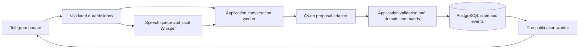

# SPEC-001: Pin overall MVP

Status: **approved**
Version: 0.18
Created: 2026-10-13 (Asia/Qyzylorda)
Owner: Pin product owner (the user)
Requirements source: [PROJECT_BRAINSTORM.md](../PROJECT_BRAINSTORM.md)
Technical reference: [proposed DDD architecture](../ARCHITECTURE.md)
Approval: the user referred to this as the approved MVP specification and requested resolving missing decisions through user-input questions on 2026-10-13. Section 11 records the answers and routine implementation details. Amendment v0.3 records the additional TR-01, bounded TR-02, and TR-03 owner decisions supplied on 2026-10-13. Amendment v0.4 records the current local-development phase boundary authorized on 2026-10-13. Amendment v0.5 records the owner's N-interval reanchoring decision supplied on 2026-10-13. Local foundation acceptance is recorded in the linked issues; overall MVP/release acceptance remains pending.
Issue package: [published MVP issue index](SPEC-001_pin_mvp_tasks.md); 28 GitHub Issues linked in section 12. Publication: 2026-10-13 (Asia/Qyzylorda); publication itself did not imply task implementation or acceptance. Live issues own subsequent execution and acceptance evidence.

Amendment v0.6, 2026-10-15: the owner removed actual Stars payment testing from required verification/acceptance. Section 11 records the scope change; payment functionality and local synthetic-event/database checks remain required.

Amendment v0.7, 2026-10-16: the owner selected a date/time interpretation error ceiling of one error per 100 unambiguous requests before manual correction. Section 11 records this partial TR-04 decision; the remaining evaluation rubric and actual qualification are still pending.

Amendment v0.8, 2026-10-16: the owner confirmed that the date/time accuracy threshold applies separately to Russian and English; aggregate performance cannot hide a failing language.

Amendment v0.9, 2026-10-16: the owner selected separate text and voice quality evaluation within each language. The date/time accuracy target applies independently to RU text, RU voice, EN text and EN voice.

Amendment v0.10, 2026-10-16: the owner confirmed that unnecessary date/time clarification on an unambiguous request is an unsuccessful quality result. Required clarification of genuinely ambiguous requests is unchanged.

Amendment v0.11, 2026-10-16: the owner selected 100 unambiguous requests per language/channel group, 400 requests total, for the future quality evaluation. This selects sample counts, not an approved corpus, collected recordings or permission to spend.

Amendment v0.12, 2026-10-16: the owner selected end-to-end request scoring: failure to produce a plan for an unambiguous request, including processing errors, counts as an unsuccessful example against the same 99% target.

Amendment v0.13, 2026-10-16: the owner confirmed MVP support for elapsed-from-now requests such as “remind me in two hours,” anchored to when the bot received that message, including delayed processing. This is distinct from event-relative reminder offsets.

Amendment v0.14,2026-10-16: the owner approved the revised RU/EN reference scripts and expected temporal calendars after recurrence was added. This approves the selected reference set, not voice recordings, API spend or measured quality; section11 binds the exact artifact.

Amendment v0.15,2026-10-16: the owner selected real human recordings for the200voice examples. This resolves audio source only; recordings, collection/acoustic protocol and execution remain pending.

Amendment v0.16,2026-10-16: the owner narrowed the current local voice check to a couple of owner-provided Russian/English examples. Use oneRU and oneENclip for a manual smoke check; the larger prepared reference set is not a prerequisite for this local check. No99%accuracy result follows from two examples.

Amendment v0.17,2026-10-16: the owner selected the user's persisted RU/EN profile language as the language supplied to voice recognition. Missing or unsupported profile language fails before inference and refunds the voice reservation; automatic language detection does not override the selected preference. This does not establish mixed-language recognition quality or broader TR-04 accuracy.

Amendment v0.18, 2026-10-17: the owner removed the 99% model-quality target, mandatory 400-request corpus, and actual-host/provider performance/economics benchmark from required MVP acceptance, not deferred. Existing two-clip RU/EN smoke and prior bounded live/offline observations remain limited evidence; none is a generalized quality, capacity or economics PASS. Further corpus/provider evaluation is optional and nonblocking, subject to separate authorization. AWS account/resource inspection, lowest-cost workable server selection/creation, app deployment and GitHub Actions CI/CD are authorized; inspect current resources, credit eligibility and costs before creating a server. Operational health, security, hosted recovery, applicable legal retention, integrated acceptance and final owner acceptance remain in scope.

## 1. Purpose, authority, and evidence boundary

Define the overall first release: a Telegram assistant that captures plans through text or voice, organizes them, delivers reminders, and checks completion with gentle accountability. Detailed business justification remains in the brainstorm; **no duplicate BR is created**. The brainstorm directly replaces the usual BR link in this specification's traceability.

This is an umbrella specification, not a sprint plan or a second task backlog. Phases describe integration order; GitHub Issues now own task contracts and execution state following authorized publication.

### Current authorized phase - AWS deployment

Owner decision, 2026-10-17: AWS account/resource inspection, selection and creation of the lowest-cost workable server, application deployment, and GitHub Actions CI/CD are authorized. Inspect current AWS resources, credit eligibility and costs before creating a server. Deployment setup is now in progress: a 4 GB Ubuntu x86_64 server was created, Docker installed, and an OIDC CI role plus production main-only GitHub environment configured; application deployment has not yet run. These setup milestones are not deployment or recovery acceptance. This supersedes the 2026-10-13 local-only phase restriction; it is authorization, not evidence of release acceptance. The benchmark requirements removed by v0.18 do not waive operational health, security, hosted recovery, legal-retention or full integration gates.

Classification used throughout:

| Label | Meaning and authority |
|---|---|
| **C — confirmed** | Explicitly recorded product/technology choices in the brainstorm; the user also explicitly required DDD in the preceding architecture request |
| **P — proposal** | A concrete recommended technical or behavioral contract, awaiting review; an existing architecture recommendation does not become confirmed by being copied here |
| **A — assumption** | A condition used to design or evaluate the MVP; validate before relying on it |
| **O — decision reference** | Originally open; current adopted resolutions are in sections 7 and 11 |

All schema shapes and internal interfaces remain technical design rather than historical brainstorm requirements. Section 11 is the current decision record and supersedes earlier open-question annotations throughout sections 2–10. O01–O17 identify resolved decision areas, not current unanswered product blockers. Earlier self-review findings are historical; their current disposition is recorded below.

### Verified repository state

At creation, the local repository is `D:\Program\python\pin`, based on commit `1ec4adfb1104f58ddb1a0553f890e7b1aa00f166`. There is documentation, project skills, and GitHub templates, but no tracked product Python code, dependency manifest, migrations, or application test suite. No running system, model evaluation, infrastructure benchmark, or unit-economics measurement was inspected or executed.

An unrelated edit to `.agents/skills/task-package-review-loop/SKILL.md` was present before this work and is outside this change. No existing issue was selected or queried. No product code, BR, issues, commits, pushes, or deployment are part of this assignment.

## 2. Requirement inventory and MVP boundary

The following IDs refer directly to brainstorm sections; they do not allocate new business requirements.

| ID | Confirmed capability / direction | Source | Boundary / adopted decision reference |
|---|---|---|---|
| R01 | Telegram is the only initial messenger; natural-language text and voice capture | §§1, 3–4 | Other messengers deferred; private chats only |
| R02 | One-off appointments/tasks, deadlines, recurring tasks, and untimed daily tasks | §3 | Supported recurrence vocabulary and editing semantics O04 |
| R03 | Ask about missing time; suggest options using known plans/preferences; allow untimed storage | §3 | One suggestion still requires confirmation; apparent gaps do not prove availability |
| R04 | Personal reminder defaults in onboarding; explicit instructions override them; confirmation shows schedule | §§2–3 | Actual defaults, day-before interpretation, past reminder handling O01–O03 |
| R05 | Appointment-end, deadline, and evening-review completion checks | §3 | Appointment duration and review scheduling O03, O06 |
| R06 | One extra nudge after an unanswered check-in with Done, Reschedule, Cancel | §3 | Delay and review-versus-item granularity O06; silence stays unconfirmed |
| R07 | Daily/weekly plan views and practical help with steps, priorities, and rescheduling | §§3–4 | View layouts and saving suggested steps/priorities O08, O09 |
| R08 | Suitable quick buttons, organized formatting, typing indicators | §4 | Parse mode, commands, layout, and fallback behavior O08, O10 |
| R09 | Quiet hours for default reminders/nudges; explicit requested times take priority with visible conflicts | §3 | Defaults, initial check-in handling, and edge conflicts O03 |
| R10 | Onboarding home zone; event-specific zones and explicit home-zone changes | §3 | Existing-plan shift choice must be clarified; DST and date rules O01, O04 |
| R11 | Russian and English conversation, voice, and date interpretation; maximum three-minute recordings | §3 | Voice oversize/failure policy O07; Kazakh later |
| R12 | Public paid launch with trial then subscription; pause reminders at trial expiry and warn beforehand | §6 | Commercial configuration/payment rules/paid expiry O11–O13 |
| R13 | Clearly stated monthly AI-chat/voice allowances; allowance exhaustion preserves active subscribers' scheduled reminders | §6 | Units, reset boundaries, reservations/refunds, and exhaustion UX O12 |
| R14 | Public landing explains product/offer and sends visitors to Telegram | §4 | Brand, content, supported site languages, framework and conversion flow O14 |
| R15 | Aiogram, PostgreSQL, SQLAlchemy, Alembic, Qwen3.7 Flash, multilingual Whisper small through faster-whisper | §5 | Provider route, versions, inference settings, integration contracts P01/O15 |
| R16 | No external calendar integration; no automatic travel detection | §3 | Availability suggestions use only shared information |

Additional confirmed design instruction: **C-DDD** — the user requested DDD for this project. The architecture document records that instruction; specific bounded contexts and deployment topology remain proposals.

### Included at MVP launch

R01–R16 together form the requested release, including paid access and the landing website. Text-only or billing-disabled internal builds may validate phases, but are **not the complete public MVP**. The draft does not reduce the launch to a free planner merely because billing decisions are open.

### Excluded / deferred

Confirmed exclusions: other messengers, external calendar sync, automatic travel detection, Kazakh at launch, separate habit streaks/analytics, and intensive/general companion coaching (brainstorm §§1, 3, 6).

Proposed exclusions: web task-management application, multi-user/team planning, attachments other than voice, outbound voice synthesis, vector search, public developer API, and microservices. These are not additions to the confirmed scope and require no speculative implementation. O17 explicitly selects private chats only.

### Targets and estimates, not promises

- C-targets: around US$5/month, under US$50/month operating budget, up to 50 daily active users (§6).
- P-host: the earlier Lightsail 4 GB / two vCPU / CPU INT8 choice remains a provisional historical option, not a required benchmark target. Inspect available AWS resources, credits and costs before choosing the lowest-cost workable server.
- A01: initial voice traffic can be handled by a bounded queue on the selected host; daily users do not specify concurrency.
- A02: the selected AI/speech routes support useful RU/EN behavior; generalized accuracy is not benchmarked or an MVP acceptance gate under v0.18.
- A03: public paid launch is economically viable at the desired affordability target; unmeasured.
- A04: the owner can supply a bot, domain, eligible AWS account/credits, and permitted model-provider account; not provisioned here.
- A05: most early interactions are independent individual plans; private-only transport is still an explicit O17 decision.

The source's pricing snapshots, 600-call examples, and Whisper benchmark are historical illustrations. They are neither actual usage forecasts nor guaranteed current tariffs, voice latency, server capacity, or net subscription revenue.

## 3. User flows

Each flow distinguishes its required outcome from the proposed mechanics and decisions that prevent final acceptance.

### F01 — Start, onboard, and establish access

C: enter from the landing or directly in Telegram; establish Russian/English conversation, confirm the home zone, and configure personal reminders. The offer is trial then subscription.

P: identify the user from Telegram, persist a profile, present concise language/zone/reminder/quiet-hour choices, and show access/allowance status. Returning users retain saved preferences. Avoid guessing a timezone from language or the server location.

Section 11 resolves O02/O03/O11/O12/O17: onboarding defaults/order, trial and allowances, and private-chat scope. Onboarding is not permission for external calendar access.

### F02 — Capture a complete one-off plan

C: receive text or supported voice, interpret the intended plan and reminders, add it to plans, and confirm the resulting schedule.

P: interpret -> validate proposal -> resolve local date/zone -> execute authorized creation -> persist -> render from the saved result. O02 now requires preview and confirmation before every change. Processing messages are not success confirmations. A duplicate update/command must not create duplicate plans.

Original check-up fixture: the user confirms a particular Friday, 14:00, and an event zone; the day-of reminder is at Friday 12:00 in that zone. The day-before reminder is Thursday at 14:00 under resolved O01. The post-appointment check-in requires an established end/duration under O06. Do not hard-code Almaty as every user's home zone.

### F03 — Missing time or ambiguous intent

C: for “exercise tomorrow,” ask for the time; use relevant known plans/preferences to offer buttons. Confirm a lone suggestion too. Provide an untimed choice. A gap is a suggestion, not asserted availability.

P: persist a draft and its missing fields, so a clarification survives restarts. Draft persistence is not an active scheduled plan. If the date, timezone, or target plan is ambiguous, ask rather than make an irreversible interpretation. Expired drafts and multiple plans from one message depend on O02/O07/O09.

### F04 — Voice capture

C: accept Russian/English recordings up to three minutes, transcribe with multilingual Whisper small through faster-whisper, then use the same task interpretation flow as text.

P: check access/allowance -> validate declared duration -> queue -> download and validate actual duration -> transcribe -> persist transcript/result -> continue F02/F03. Keep inference out of the bot's async event loop. Show truthful processing status.

O07/O12/O15/O16 govern file limits, >180-second UX, retries, language selection, queue expectations, inaccurate transcription handling, and audio deletion. Never silently truncate >180 seconds into a valid plan under an invented policy.

### F05 — Create and manage recurring plans

C: support recurring plans.

P: separate series from generated occurrences, show the resolved repeat schedule, and identify occurrences by stable keys. Each occurrence has independent completion truth; completing one does not complete future repetitions. Offer explicit single-occurrence versus series actions where supported.

O04 is resolved in section 11: daily/weekly/monthly rules, clamp/shift exceptions and this-or-future changes. Unsupported exotic recurrence is excluded.

### F06 — Today/week views and practical support

C: show organized plans for today and the week; help with prioritization, breaking down work, and rescheduling. Include untimed plans without fabricating a time.

P: query persisted data in the selected display zone, distinguish completed/cancelled/open items, paginate long results, and use localized templates. Advice creates no tasks/steps/priorities until the user requests a supported mutation and the approved confirmation policy permits it.

O08/O09 govern week boundaries, filters/layout, empty states, suggested subtasks/priority storage, and multi-task batch semantics. No external calendar data is fetched.

### F07 — Scheduled reminder and completion cycle

C: deliver requested/default reminders according to saved preferences. Send a check-in after appointment end or deadline, or during evening review for untimed tasks. After silence, send one extra nudge with Done/Reschedule/Cancel; silence never means completed or failed.

P: separate notification intention from delivery outcome. Start an unanswered timer after confirmed check-in delivery, not queue insertion. Group evening-review behavior is O06. Default reminders/nudges obey quiet hours; explicitly requested reminder times take priority and conflicts are visible.

Resolved O03/O05/O06 specify quiet-hour handling, one-hour nudge, late recovery, and explicit send-race limitations in section 11.

### F08 — Done, reschedule, cancel, and preference changes

C: Done, Reschedule, Cancel are available on follow-up nudges. Users can specify another event zone or change their home zone; ask how existing plans should shift.

P: server-derived identity authorizes the action; enforce the expected plan version. Done records completion, Cancel records cancellation, Reschedule updates the plan/reminder schedule. Subsequent notification dispatch reads current plan state. Stale buttons do not overwrite newer changes.

O02/O04/O05/O13 govern confirmation, reopening, series effects, in-flight delivery, already-expired access, and non-AI editing rights. No claim is made that a sent/in-flight Telegram message can always be withdrawn.

### F09 — Trial, payment, allowance exhaustion, expiry

C: offer trial then subscription with monthly allowances. Warn before trial expiry; at expiry pause reminders, preserve tasks, and explain inactivity and how payment can resume service. Active subscribers' reminder delivery remains independent of AI/voice allowance exhaustion.

P: maintain entitlement and metered usage as separate concepts; payment receipts, not clicks or AI statements, grant paid access. Record payments idempotently. Production billing is disabled until commercial/platform decisions are approved and verified.

Resolved O11–O13 adopt seven days, 250 Stars/30 days, auto-renewal, manual refunds, defined usage periods and expiry/resume rights. Platform/account eligibility is still verified before launch; no exact US$5 equivalence is claimed.

### F10 — Landing conversion

C: describe the product and trial/subscription offer, then direct visitors into Telegram.

P: responsive public page with a configured bot link, representative interaction example, and accurate limitations. No checkout, analytics, account system, or guaranteed conversion rate is implicitly added. Website languages, brand, framework, and offer wording are O14/O11.

## 4. Proposed architecture and stack

P01: adopt the [architecture document](../ARCHITECTURE.md) as a technical proposal, subject to this spec's decision ledger. A DDD modular monolith uses ports/adapters in one codebase with separate transport, application, delivery/schedule, and speech processes. PostgreSQL owns persisted truth, inbox/outbox, and leased jobs. Domain code remains independent of Aiogram, ORM mappings, and model providers.

| Boundary | Responsibility and owned truth | Interfaces to others |
|---|---|---|
| Identity & Preferences | User binding, language, home zone, notification defaults | Immutable preference/identity snapshots |
| Planning | Plan definitions, series, occurrences, reminder rules, completion | Commands, agenda queries, versioned events |
| Accountability | Check-in cycles, unanswered follow-up policy, evening reviews | Planning results/events; notification requests |
| Conversation | Drafts, clarification, bounded AI context/action proposals | Published Planning and Access contracts |
| Billing & Access | Trials, paid periods, allowance reservations, receipts | Authoritative access checks and usage contracts |
| Notifications | Notification intents, destination state, delivery attempts | Current eligibility checks and Telegram send adapter |

Speech is an infrastructure port, not a separate business domain. Telegram is a transport, not a source of business rules. Do not import another context's ORM model to bypass its application contract. Commands own short Units of Work; framework-free aggregates enforce invariants. Events carry context-owned versions and consumer deduplication IDs.

Confirmed stack: Aiogram, PostgreSQL, SQLAlchemy, Alembic, Qwen3.7 Flash, multilingual Whisper small, faster-whisper. Proposals inherited from the architecture: Python 3.12, aiohttp webhooks, Pydantic, Psycopg, HTTPX/OpenRouter, PostgreSQL job ledger, dateutil/zoneinfo, MarkdownV2 templates, Caddy, Compose, uv, pytest/type/import checks, and static HTML/CSS landing. Section 11 selects the initial provider/formatting/topology; exact compatible versions and functional integration are verified during implementation. Server selection follows the inspect-first, lowest-cost v0.18 authorization. No package is installed by writing this spec.

Proposed runtime flow:

The arrow back to Telegram represents external delivery, not a transaction with the database. Eventual consumers re-check current state. A model outage must not disable independent due-reminder processing (P02 reliability proposal).

## 5. Proposed data and state model

These logical fields describe contracts, not an approved physical migration. Table names, schema splits, identifiers, indexes, retention, and release-compatible migrations follow architectural review. Keep temporal instants and intended local calendar meaning separately.

| Entity / value | Required logical information | Lifecycle / invariants |
|---|---|---|
| UserProfile | Internal owner ID, Telegram binding, language, home-zone identifier, preference version | Profile creation/update is idempotent; no cross-user binding collision |
| NotificationPreferences | Default reminder rules, quiet interval/zone, review settings | Explicit/default provenance is retained; exact initial values O03 |
| PlanItem | Owner, title, kind, optional location/detail, local schedule or date, event zone, version | One-off definition; untimed is distinct from midnight |
| PlanSeries | Owner, repeat specification, anchor schedule/zone, generation, end condition | Repeat vocabulary/invalid dates/end behavior O04 |
| Occurrence | Owner, plan/series reference, stable recurrence key, resolved instants/date, state/version | `open -> completed` or `open -> cancelled`; reschedule retains identity |
| ReminderRule | Relative/calendar rule, explicit/default origin, applicability | Generate instants only after O01/O03 semantics are resolved |
| Draft | Owner, originating message, proposal, missing fields, expected versions, expiry | `collecting -> ready -> applied/abandoned/expired`; ready is not saved plan |
| CheckInCycle | Occurrence/review reference, schedule version, initial/nudge intents, response | `scheduled -> awaiting_response -> nudged -> answered/closed`; one extra nudge at most |
| AccessAccount | Trial/paid validity, policy version, access status | Trial expiry pauses reminders; paid-expiry semantics O13 |
| UsageReservation / Ledger | Owner, policy period, unit/amount, request/call ID, reservation/settlement | Reserve atomically; settlement/refund rules O12; measure actual provider cost separately |
| PaymentReceipt | Order/owner, provider transaction identity, amount/currency, period, outcome | Valid receipt only; unique processing; refund policy O11 |
| NotificationIntent | Owner, target, kind, due instant, version, provenance, delivery eligibility | Pending/leased/sent/cancelled/paused/failed/unknown as proposed operational states |
| Inbox / Job / Outbox | Update/work/event key, payload version, availability, lease token, retries/receipt | Durable receipt, deduplication, lease recovery, idempotent consumers |
| DeliveryAttempt | Intent, checked versions, attempt key, provider result/message ID, timestamps | Attempt outcome does not assert user completion or exactly-once delivery |

Overdue is a derived property of an open timed occurrence, not proof of failure. No completed/failed transition is inferred from silence. Reopening completed items is not agreed scope (O04).

Proposed temporal contract: UTC scheduling instants plus IANA zone and intended local date/time; injected clock/reference date for natural-language parsing. Repetition generation uses stable `(series, recurrence_key)` identity and versioned exceptions. Resolved O04 clamps missing monthly days and shifts DST gaps. This supersedes the architecture's older skipping proposal.

Proposed separation of state prevents false conclusions: an active subscription with exhausted chat quota can still receive reminders; an expired trial with unused quota cannot. A completed occurrence invalidates future check-in eligibility even if an older event is consumed later. Scheduled, dispatched, delivered, and completed are distinct facts.

## 6. Key contracts and failure behavior

All K-contracts are proposed engineering requirements for review. They implement C scope but introduce no guessed product defaults.

| ID / contract | Input | Successful output / persisted effect | Validation, failure, idempotency |
|---|---|---|---|
| K01 ReceiveUpdate | Authenticated Telegram update and bot identity | Durable inbox item and work reference; acknowledge after commit | Unique bot/update identity; reject unauthenticated input; database failure is not successful receipt |
| K02 InterpretPlan | Owner-derived context, text/transcript, reference date/zone, relevant plans/preferences | Typed reply/proposal or clarification request; no direct writes | Bound context/calls; reject invalid model output; provider/tool errors cannot claim a saved plan |
| K03 ApplyPlanCommand | Owner, action key, validated fields, expected version, approved policy | Persisted plan/occurrence plus mutation receipt and events | Ownership, time/kind/recurrence invariants, access and stale-version checks; duplicate action returns original result |
| K04 GetAgenda | Owner, local interval/display zone, supported filters | Structured saved-plan results | Resolve interval under approved O08 policy; isolate tenants; no invented plans from model memory |
| K05 ChangeOccurrence/Series | Owner, target/scope, expected version, explicit change | New version, stable identity, invalidation/replacement of future intents | Series effects O04; stale conflict requires fresh state; consumer rechecks current version |
| K06 TranscribeVoice | Owned recording reference, declared/decoded length, usage reservation | Source-language transcript and continuation reference | <=180 seconds; untrusted files; bounded jobs; duplicate continuation cannot create duplicate plans; policies O07/O12 |
| K07 DispatchNotification | Due intent with target/version and current access snapshot | Attempt outcome and provider message ID when confirmed | Re-check state/access/quiet policy immediately before send; confirmed transient retries vs uncertain send outcomes distinguished |
| K08 RecordCompletionResponse | Owner-bound callback/message, target/version, Done/Reschedule/Cancel | Planning result and closed/updated accountability cycle | No cross-user token use; at most one nudge per approved cycle; late/stale response conflict rules O04/O06 |
| K09 CheckAccess/ReserveUsage | Owner, operation, current instant, requested units/policy period | Permit/deny and durable reservation | Access separate from quota; concurrent reservations cannot exceed allocation; units/defaults O12/O13 |
| K10 ApplyPayment | Validated payment/order/charge identity and period | Unique receipt and authoritative access change | Never grant on invoice/pre-checkout approval alone; duplicate charge is idempotent; route/refund/renewal rules O11 |
| K11 ResolveDraft | Owner-bound draft/version plus clarification/confirmation | Updated draft or K03 execution | No write on missing required details; draft expiry and batch application O02/O09 |

### Transaction and external boundary

P: aggregate mutation, command receipt, and emitted events commit together. Use short isolated sessions per command/concurrent worker. Claim jobs with leased ownership and stale-worker fencing; run model/inference/network calls outside database transactions. Consumers persist effects and deduplication receipts atomically. Reconciliation repairs missed intent generation without changing business state from guesses.

### Error classes

- Validation/ambiguity: ask for missing information; no false success or unauthorized write.
- Unauthorized/stale target: reject or refresh; do not apply to another user's or a newer plan.
- AI/speech unavailable: report failure/progress honestly; retry only under approved budgets; preserve existing schedules.
- Quota exhausted: explain relevant remaining access; preserve active subscribers' reminders (C R13).
- Trial expired: pause reminder eligibility, retain records, show resumption path (C R12).
- Confirmed Telegram failure: classify retryability and destination status; honor platform rate limits after current verification.
- Unknown Telegram outcome: record uncertainty. P: do not blindly retry unknown sends; final retry-versus-loss policy is O05.
- Downtime: reconcile due work and recurrence; late/backlog behavior is O05, not an invented grace window.
- Cancel/send race: invalidate future intent eligibility, but an already-started external send may still arrive. Owner approval of this limitation or another supported mitigation is O05.

### Security, privacy, and migration

P: derive actor identity server-side; authorize all reads/writes; validate all AI/transport fields; keep secrets out of prompts/logs; model tools cannot access SQL, payments, arbitrary URLs, or files. Formatting escapes user input. Limit file size, decoded duration, provider calls, and concurrency after O07/O15/O16.

No current schema exists. Proposed initial Alembic migrations create owned tables/constraints and inbox/outbox together, with tests on real PostgreSQL. Before launch, define rollback/backup-restore and policy-version behavior; never treat rollback as permission to delete user/payment records. Retention, deletion, backup lifetime, and recovery targets are O16; the architecture's numerical examples remain proposals.

## 7. Decision ledger (resolved)

Section 11 records exact choices and routine implementation defaults. The prior open decisions are retained as stable references for traceability, not as a live blocker list.

| ID | Current contract / resolution |
|---|---|
| O01 | Same-local-time previous calendar day; exact elapsed offsets remain distinct; clarify ambiguous dates and past requested times. |
| O02 | Preview every mutation and confirm before saving; atomic editable batches; explicit onboarding and 24-hour draft lifetime. |
| O03 | Default reminders one day/one hour; quiet hours 22:00–08:00; review 20:00; defer eligible defaults and disclose omitted reminders. |
| O04 | Daily/weekly/monthly recurrence; missing monthly date clamps; DST gap shifts; edit this or this-and-future; preserve history and ask about zone changes. |
| O05 | Useful future-event reminders and one recovery summary; no automatic unknown-send retry; document unavoidable in-flight race. |
| O06 | Ask appointment end/duration; check at end/deadline; grouped evening review; extra nudge after one hour; silence stays unconfirmed. |
| O07 | Maximum 180 seconds; reject oversize, clarify unusable audio, queue with status, refund unsuccessful processing allocations. |
| O08 | Monday-start local week, localized templates, deterministic commands, explicit empty/untimed/overdue views. |
| O09 | Editable atomic batches; advice saved only on request as ordinary previewed tasks; no dedicated subtasks/priority schema. |
| O10 | MarkdownV2 with escaping, focused inline buttons, truthful processing/typing, safe format-error fallback. |
| O11 | Seven-day trial after onboarding; 250 Stars/30 days, auto-renew/cancel; manual support refunds; receipts grant access. |
| O12 | Paid 1,000 AI turns/60 voice minutes; trial 250 turns/15 minutes; period-based atomic reservations, no rollover, failed-work refunds. |
| O13 | Trial/paid expiry pauses reminders/new planning; allow viewing, completion and cancellation; useful recovery on renewal. |
| O14 | Pin, Russian/English responsive referral landing, product examples and truthful price; no website checkout or analytics. |
| O15 | Executor adopts referenced modular-monolith technical design; dependency/provider locks verified during implementation. |
| O16 | Audio deleted after processing, text 30 days, plans until deletion, backup seven days; explicit qualification/recovery/financial-retention gates. |
| O17 | Private bot chats only. |

No unanswered MVP behavior choice is used as an implementation prerequisite. Real-host qualification, payment eligibility, legal financial-record retention, secrets/domain provisioning, and cost/recovery evidence remain release gates; answering product questions cannot prove those facts.

## 8. Implementation phases and exit conditions

No live progress, issue numbers, or assignees are allocated here. Section 11 resolves product policies; phase exits still require actual implementation evidence.

| Phase | Integrated outcome | Prerequisites and decision gates | Exit evidence |
|---|---|---|---|
| PH1 Foundations | Domain boundaries, identity, validated settings, UoW, initial migrations, durable inbox | O15/O17 and data/security portion of O16 | Architecture/import checks, tenant constraints, receipt/restart tests on PostgreSQL |
| PH2 Text capture and agendas | F01–F03/F06 through typed commands and drafts; timed/untimed storage | PH1; O01/O02/O08/O09, applicable O03 | AC01/AC02/AC04/AC09/AC13 plus invalid/duplicate/stale input fixtures |
| PH3 Scheduling and recurrence | App-owned reminders and stable recurring occurrences | PH2; O03/O04/O05 | AC05/AC06/AC11/AC12/AC17 with restart and race evidence |
| PH4 Accountability | End/deadline/review check-ins and one extra nudge with actions | PH3; O06 and F08 policies | AC07/AC08/AC12, confirmed-delivery versus silence tests |
| PH5 Voice and model integration | Shared text/voice command flow; bounded local recognition; provider usage and failure behavior | PH2; O07/O12/O15/O16; integrate PH3/PH4 for functional seams | AC03/AC16; functional route and confirmation boundaries; no quality/capacity benchmark required by v0.18 |
| PH6 Paid access and landing | Trial/subscription/payment/allowance boundaries plus referral page | PH2–PH5; O11–O14 and provider rules verification | AC14/AC15/AC19, duplicate/failed payment and exhaustion integration checks |
| PH7 Overall acceptance | End-to-end complete public MVP and operational recovery | All applicable decisions approved; PH1-PH6 integrated | Remaining AC evidence, backup restore, restart/unknown sends, operational health/security/legal retention, and owner acceptance; no model-quality/capacity/economics benchmark is required under v0.18 |

Build scheduling first against validated commands; add AI as a proposal adapter rather than letting it define persistence. Speech and reminders need independent worker capacity. Development trials may use explicit fixtures; those fixtures must not turn into trial/pricing defaults. A staging system is for verification, not an implicit public launch.

## 9. Acceptance criteria and verification mapping

All criteria are **unexecuted**. C denotes a confirmed product outcome and P supporting engineering proof. O references now link to settled section-11 policies; remaining gates concern executed evidence, not missing product choices.

| AC | Basis and observable acceptance result | Decisions / evidence needed |
|---|---|---|
| AC01 | C: onboarding persists the user's selected language/home zone and personal reminders; returning sessions recover them | O02/O03/O11/O17; RU/EN onboarding and restart integration |
| AC02 | C/P: complete text capture produces one owned saved plan and a truthful confirmation with resolved schedule; duplicate delivery creates no second plan | O01/O02/O09; persisted-state plus message and command-retry evidence |
| AC03 | C: a valid 180-second-or-shorter recording can produce RU/EN text and the same validated creation/clarification outcome as text; >180 seconds cannot be accepted as a valid full recording | O02/O07; actual voice fixtures and duration boundary checks; no claimed perfect recognition |
| AC04 | C: absent time asks and offers appropriate choices/untimed option; one suggestion is confirmed; explicit reminders override defaults and appear in confirmation | O01/O02/O03; ambiguous, sole-option, multiple-option, untimed, conflicting-default fixtures |
| AC05 | C: confirmed Friday 14:00 check-up sends Friday 12:00 reminder and approved Thursday reminder; quiet conflicts are shown and explicit times take priority | O01/O03/O05; controlled clock plus delivery evidence, Thursday 14:00 fixture fixed in section 11 |
| AC06 | C/P: a supported series produces distinct identifiable occurrences; completing one does not complete the next, and repeated generation does not duplicate it | O04; approved repeat fixtures, persisted identity and concurrent reconciliation tests |
| AC07 | C: appointment check-in follows established end, deadline check-in follows deadline, and untimed items appear in evening review | O03/O06; selected timing/zone policies and controlled-clock scenarios |
| AC08 | C: ignoring a delivered check-in produces exactly one additional nudge under the approved delay/granularity, with Done/Reschedule/Cancel; silence leaves completion unconfirmed | O06; failure-before-delivery, retry, multiple idle cycles, and action-response evidence |
| AC09 | C: today/week views reflect saved plans and distinguish untimed items without inventing time; empty/long agendas are usable | O08; approved week/zone/filter/pagination fixtures and rendered messages |
| AC10 | C: localized organized text, suitable buttons, and typing/processing indicators work in actual Telegram; user text cannot corrupt formatting | O08/O10; supported-client screenshots and malformed markup fixtures |
| AC11 | C: selecting an event zone uses that zone; changing home zone asks about affected existing plans and applies only the chosen effect | O04; explicit-zone, DST, and bulk-version integration evidence |
| AC12 | C/P: accepted Done/Cancel/Reschedule updates the correct occurrence and future reminder eligibility; obsolete/stale commands do not revert newer state | O02/O04/O05/O13; send-race outcome recorded honestly; no absolute retractability claim |
| AC13 | C: practical support suggests steps/priorities/rescheduling from shared plans, without claiming external-calendar availability or unrequested successful writes | O09; RU/EN dialog and requested-versus-advisory mutation evidence |
| AC14 | C: before trial expiry approved warnings are sent; expiry retains tasks but pauses reminders; exhausted allowances for an active subscriber do not stop existing reminders | O11/O12/O13; clock-boundary, queued-delivery and concurrent-reservation tests |
| AC15 | C: landing explains the approved product/offer and its primary link opens the intended bot | O11/O14; responsive deployed/staging screenshots and real deep-link check; conversion rate not guaranteed |
| AC16 | C/P: RU/EN text and voice features remain in product scope; functional integration is covered by AC02/AC03/AC13 and the core integration gate. The 99% quality target, fixed-size corpus, and actual-host/provider capacity/economics benchmark are removed from required acceptance. | v0.18; preserve bounded observations without claiming generalized quality, capacity, or economics |
| AC17 | P: restart/worker failure preserves committed plans and due work; duplicate jobs/events cannot duplicate mutations; unknown external send outcomes stay visible | O05/O15/O16; real PostgreSQL lease/retry/fencing, crash-stage and outage evidence |
| AC18 | P: another user's IDs/buttons/proposals cannot read or mutate data; invalid webhook/AI payloads cause no protected writes; validated backup can restore agreed state | O15/O16/O17; tenant, injection, authenticated transport, and disposable restore checks |
| AC19 | C/P: only validated payment evidence grants the approved paid period; duplicate charges/failed checkout do not grant twice; quota and entitlement policies apply independently | O11–O13; provider sandbox/live-boundary contract and failure evidence |
| AC20 | P: documented retention/deletion and operator recovery match approved policies, including temporary audio, logs, backups, and payment records | O16; timed cleanup/deletion tests, redacted logs, retention/restore evidence |

Per-check evidence must record the command/scenario, date, environment, tested revision/dirty boundary, actual output/artifact, and limitations. Unit tests prove rules; PostgreSQL tests prove leases/transactions; provider/Telegram checks establish only the behavior they observe. Model-quality and actual-host qualification are removed by v0.18; no local test or small sample establishes generalized accuracy, capacity, or economics. No single check proves the complete product.

## 10. Traceability, rollout, and review record

| Source requirement | Specification contract | Acceptance | Future issue / executed evidence |
|---|---|---|---|
| R01/R03/R10/R11 | F01–F04, K01–K03/K06/K11 | AC01–AC04/AC11 | Not created / not executed |
| R02/R04/R09 | F02/F05/F07/F08, K03/K05/K07 | AC04–AC06/AC11/AC12 | Not created / not executed |
| R05/R06 | F07/F08, K07/K08 | AC07/AC08/AC12 | Not created / not executed |
| R07/R08/R16 | F03/F06/F10, K02/K04 | AC09/AC10/AC13/AC15 | Not created / not executed |
| R12/R13 | F09, K09/K10 | AC14/AC19 | Not created / not executed |
| R14 | F10 | AC15 | Not created / not executed |
| R15/C-DDD + assumptions | Architecture, data model, K01–K11, PH1–PH7 | AC16–AC20 and architecture checks | Not created / not executed |

Release conditions: owner-approved spec and resolved launch blockers; successful phase integration and recorded end-to-end acceptance; current platform and synthetic payment-behavior checks; working authorized deployment with operational health/security controls; tested restore and incident procedures; applicable legal financial-retention evidence; truthful pricing/limits/privacy disclosures. AWS server creation, app deployment and GitHub Actions CI/CD are authorized subject to inspect-first, lowest-cost selection. Model-quality/corpus/actual-host benchmarking is not a release condition; authorization and local evidence do not themselves establish deployment or overall acceptance.

### Local self-review, 2026-10-13

Reviewed source snapshot: brainstorm and architecture at local base `1ec4adf`; new draft is uncommitted. Method: local `spec-task-review` checklist against source documents and verified absence of product implementation. No delegated review, live issue audit, or runtime proof.

Verdict: **draft suitable for product/architecture review; not ready as an unconditional implementation contract**.

| Finding | Severity / evidence class | Impact and action |
|---|---|---|
| SR01 | HIGH; confirmed document gap, not runtime bug | O01–O06/O09 leave central plan/notification semantics unsettled; affected AC02/AC04–AC08/AC11/AC12/AC13. Resolve decisions with acceptance fixtures before dependent work. |
| SR02 | HIGH; confirmed document gap | O11–O13 block complete paid launch and AC14/AC19; specify/verify commercial and platform rules rather than assuming a trial length or Stars price. |
| SR03 | MEDIUM; original review found runtime/capacity evidence unconfirmable | A01-A04 and O15/O16 lacked model/server/cost/restore evidence for AC16-AC20 at that review. v0.18 removes model-quality/capacity/economics benchmarking from required acceptance; reliability and recovery evidence remain. |
| SR04 | MEDIUM; confirmed design boundary | Unknown sends and in-flight cancellation cannot be proven safe solely by a successful DB mutation. O05 must choose supported outcomes; test external-consumer failure paths for AC12/AC17. |

Confirmed: source scope and choices are mapped. Partial: architecture provides concrete proposed contracts. Unverified: runtime reliability, current prices, payment eligibility, operational recovery and release readiness. Model quality and host suitability are not claimed as passed; their quantitative benchmark is no longer an MVP acceptance gate under v0.18.

Document verification: on 2026-10-13, a PowerShell-hosted Python structural check in `D:\Program\python\pin` verified balanced Markdown fences, existing local Markdown links in the three edited documents, and complete/valid R/O/K/PH/AC identifiers; it passed. `git diff --check` also passed. Evidence was the local command output in this authoring session, against base `1ec4adf` plus this uncommitted draft and README/index changes. The existing review-skill edit remained untouched. These are document checks, not product tests or independent review.

No acceptance criterion was marked passed by the original review. Subsequent owner approval and decision resolution are recorded in section 11; no product implementation, GitHub issue, or deployment has been created.

## 11. Adopted MVP decisions — 2026-10-13

Approval evidence: the user's request to decompose the “approved Pin MVP specification,” followed by the instruction to elicit missing decisions with the request-user-input tool. The reviewed pre-edit v0.1 file had SHA-256 `233119de526690ce8b45e711bc092e51c637f013a497a4beb8a2ad76a3fa2b8d`. This is local source evidence, not a committed approval revision. The brainstorm stays unchanged as the historical requirements source.

### Choices explicitly selected by the user

- **Local landing destinations, 2026-10-15:** both the primary bot CTA and support link use `https://t.me/pin_appbot`, as supplied by the owner. Support instructions identify `/support` and `/paysupport`; no separate support account, automatic ticket routing or unsupported bot start payload is implied.
- **Owner scope amendment, 2026-10-15:** actual Telegram Stars payment testing (including Test Server top-up, actual checkout/receipt, renewal/cancellation and refund transactions) is removed from required verification and acceptance, not deferred to a later gate. This supersedes payment-test/provider-payment-proof requirements elsewhere in this specification and tasks #20, #26 and #28. Keep the Stars payment feature and validate its application logic locally using synthetic trusted transport events and PostgreSQL, including receipt validation/idempotency, access periods, refunds, quotas and expiry. Such evidence must be labelled synthetic; it does not establish actual provider operation. This change does not authorize real payments or deployment and does not remove unrelated legal, model-provider or hosting requirements.
- Preview **every change**, including Done, cancellation, editing, and creation; persist only after confirmation. Multiple tasks use one editable, fully clarified, atomic batch. Cancelling a draft has no plan effect.
- “One day before” means the same local time on the preceding calendar day; “24 hours before” is an elapsed offset.
- Onboarding reminder suggestions: one calendar day and one hour before timed plans, editable by the user.
- Quiet hours 22:00–08:00 apply to defaults, initial completion checks, and nudges; explicitly requested reminder times take priority with visible conflicts.
- One evening review at 20:00, editable, for outstanding untimed tasks; task-specific actions and at most one summary follow-up.
- Ask for missing appointment duration/end; completion check at confirmed end. Extra nudge one hour after confirmed check-in delivery, deferred out of quiet hours.
- Daily, weekly, monthly repeats with N-intervals, selected weekdays, monthly day/last-day, optional end date or count. Missing monthly day uses the month's last day but retains the original pattern. DST forward gaps shift that occurrence forward by the gap.
- Recurring changes offer this occurrence or this-and-future; past history remains unchanged.
- Trial starts after completed onboarding, lasts seven days, and includes 250 AI turns and 15 voice minutes.
- One paid plan: **250 Stars per 30 days**, auto-renewal disclosed, cancellation retains paid-through access. Allowances: 1,000 AI turns and 60 voice minutes per paid period. A user turn is one AI interaction, not each internal model call; deterministic commands/buttons do not consume AI allowance.
- Trial/paid expiry pauses reminders and new planning/AI/voice, while preserving view, complete, and cancel actions.
- Recovery/renewal sends useful coalesced reminders if the event is still ahead, skips expired advance reminders, and offers one summary of unresolved past tasks; never auto-reschedules.
- Avoid duplicates: no automatic retry of an unknown Telegram send outcome. Confirmed transient failures remain retryable. Record uncertainties for investigation.
- Manual payment-support refund review; refund confirmed duplicate/incorrect charges and comply with applicable requirements.
- Delete raw audio after processing; text retained 30 days; plans retained until account deletion; backups expire after seven days; financial receipts handled separately.
- Suggested steps/priorities stay as advice; create ordinary tasks only when the user requests them and confirms a preview. No dedicated subtask/priority hierarchy.
- Private chats only. Landing name Pin, Russian and English, simple responsive product/offer/examples page and Open in Telegram CTA; no checkout/analytics initially.

### Additional owner decisions — TR-01, TR-02, and TR-03, 2026-10-13

Additional owner clarification, 2026-10-15: Pin's intended legal operating jurisdiction and revenue-receiving country is **Kazakhstan**. The owner has not yet selected the entity form (sole proprietor/IP versus TOO). Tax regime and the applicable financial-document categories/retention schedule remain to be validated. This identifies the jurisdiction for the existing financial-retention gate; it selects no numeric retention duration and does not authorize financial-record erasure or deployment.

- **TR-01 recovery after an appointment:** If an outage ends after an appointment's expected end and no initial completion check was delivered, send a late completion check. The normal maximum of one follow-up applies; its timer starts one hour after confirmed late-check delivery, and quiet hours defer it. If a recovery summary is also sent, it may report the unresolved item but must not create a second check/nudge campaign. Preserve the existing one-summary deduplication and never revive an exhausted cycle.
- **TR-02 this-and-future weekly count:** For a weekly workout series with count 10 and four completed occurrences, moving occurrence five from Monday to Wednesday with this-and-future moves the six remaining occurrences to Wednesdays. This-and-future edits preserve the remaining occurrence count; the count does not restart. The owner additionally confirmed the N-interval anchor choice using a two-week fixture: dates June 1, June 15 and June 29 become June 8, June 22 and July 6 when June 1 moves to June 8 with this-and-future. Future interval counting starts from the newly selected occurrence date; the remaining count does not restart, and prior history remains unchanged. Existing supported weekday/monthly-pattern and DST rules still apply; any changed pattern fields and the resulting future dates must be displayed in the confirmed preview.
- **TR-03 return after deletion:** If the same Telegram identity returns after account deletion, retain only the minimum identity-linked record needed to remember prior trial use and any currently active paid coverage. Restore access for that active paid coverage, but do not restore deleted plans. These are the only approved purposes for the retained return record. Keep the prior-trial and active-coverage facts available as needed to enforce this no-reset/restore rule. No numeric retention period was selected; do not invent one or treat this policy marker as a legal financial-retention rule. This detail does not block independent foundation work. Statutory/financial record retention remains a separate, actual-jurisdiction evidence requirement.

### Historical TR-04 owner decisions (2026-10-16; evaluation requirements superseded by v0.18)

The owner selected **no more than one date/time error per 100 unambiguous requests**, assessed on the assistant's proposed plan before the user corrects or confirms it (at least 99% correct date/time interpretation in the evaluated set). This is an acceptance target, not a measured result or a statistical guarantee about all future requests. Existing ambiguity-clarification requirements remain unchanged.

Follow-up owner decision, 2026-10-16: apply this ceiling **separately to Russian and English**. Each language must meet at least 99% date/time correctness; a combined RU/EN average cannot compensate for either language failing. A further owner answer on the same date requires separate text and voice scores within each language: **RU text, RU voice, EN text, EN voice must each meet the 99% target**. A good result in another group cannot compensate for a failing group. Voice evaluation follows the proposed plan produced from the original recording; a text-only transcript check does not prove voice-input accuracy.

Further owner decision, 2026-10-16: when the request already makes the date and time unambiguous, asking for that information again counts as an **unsuccessful quality result**. The correct proposed plan must not require unnecessary temporal clarification. Retain such requests in the evaluated group's observations; do not treat the extra question as a successful interpretation. Necessary clarification of ambiguous or missing information remains required.

Further owner decision, 2026-10-16: score the complete request-processing chain. If an unambiguous request produces no proposed plan, including when processing returns an error, the example is unsuccessful against the **same 99% target**; it is not excluded or counted only in a separate reliability metric. Record the failure reason separately for diagnosis. Together with the confirmed temporal-error and unnecessary-clarification rules, count successful/unsuccessful **requests**, not individual mismatching fields: each group of 100 must have at least 99 successful requests and at most one unsuccessful request before manual correction. Necessary clarification cases remain a separate policy check, not part of the approved 400 unambiguous requests.

Subsequent explicit owner decision, 2026-10-16: the future quality evaluation uses **100 unambiguous requests in each of RU text, RU voice, EN text and EN voice — 400 requests total**. Each group is evaluated independently against its approved99% target. This approves the sample counts only, not the actual prompts/recordings, corpus representativeness, execution budget or measurement results. The earlier illustrative100-request question alone did not approve those counts; this later answer does. Actual corpus/recordings and representativeness, reproducible reference clocks/zones, ambiguity-test coverage, representative workload/bursts and cold/warm runs still need an explicit evaluation protocol and owner suitability approval. No quality, cost, capacity or whole TR-04 PASS is implied. As of 2026-10-16, additional model spend and actual-host/deployment work remained outside that earlier authorization; v0.18 supersedes this boundary. This prior plan was superseded by owner amendment v0.18 and is no longer required acceptance.

### Text/reference set approval — owner decision, 2026-10-16

After requesting recurring-task examples, the owner explicitly approved the revised **texts and expected dates**. The selected reference composition contains100distinct RU and100distinct EN scripts paired across the four100-slot groups, including10elapsed-from-receipt and10finite-recurring scripts per language. The approved temporal references include all80RU/ENrecurrence occurrences. This subsequent approval resolves the script/reference selection left open by the earlier sample-count decision.

The [approval record](../qualification/TR-04_reference_set_approval.md) binds `TR-04_evaluation_candidates.jsonl` at revision`de28299`, Git-blob SHA-256`8e825856284f6e52aadcf63edd689122ae27e85df78053724f7c54b3d2bebd40`. Preserve the approved inputs and expected calendars. Real audio is absent; its source/eligibility and acoustic sampling, workload/bursts/cold-warm measurement and actual host/provider evidence remain pending. No additional API spend, recording, deployment, measured accuracy or suitability approval follows. Existing99% end-to-end scoring is unchanged. This approval is retained for history; v0.18 makes the corpus and evaluation optional.

### Human audio source — owner decision,2026-10-16

The owner selected **real human recordings** for the100RU and100ENvoice inputs, rather than local speech synthesis or a mixed set. Use the already approved reference scripts; preserve original audio and stable IDs. This chooses the source, not actual recordings, participant/acoustic sampling, collection/eligibility/handling protocol or execution budget. The [recording kit](../qualification/recording_kit/README.md) contains only derived scripts and a blank tracker; no recordings or quality result exist.

### Bounded RU/EN voice smoke - completed, 2026-10-17

The earlier owner decision narrowed this voice smoke to a couple of owner-provided Russian and English examples; those requested examples have now been completed. Keep the resulting observations bounded: they establish no generalized accuracy, representative audio quality, host capacity or economic suitability. The larger reference set and recording kit remain optional artifacts; broader corpus/provider evaluation is nonblocking under v0.18 and requires separate authorization.

### Voice recognition language — owner decision,2026-10-16

Use the language explicitly selected in the user's persisted profile (ru or en) for local voice recognition. Pass it through the worker and recognition adapter to Whisper; backend language guesses do not replace it. If the profile or valid selection is missing, do not infer a language: finish the bounded voice job as a failure before inference and refund its reservation. This decision governs functional language selection; it is not a generalized recognition-quality claim.

Record original audio, actual local Whisper transcription and any executed downstream interpretation separately where available. The completed two-clip smoke is bounded evidence only; it establishes no generalized accuracy, representativeness, host capacity or cost suitability. Under v0.18, broader corpus/model evaluation is optional, nonblocking and requires separate authorization. [Current smoke worksheet](../qualification/TR-04_manual_smoke.md).

### Receipt-anchored relative time — owner decision, 2026-10-16

The MVP supports unambiguous elapsed-from-now requests such as “remind me in two hours.” Compute the requested instant from **the bot's receipt of that message**, not from later processing, speech completion, retries or model-call start. Preserve a stable aware reference instant for the original text/voice input across those boundaries and give the interpreter the full temporal context needed to calculate the result. Keep profile-local reference date and reference instant consistent. A later queue delay must not silently move the requested schedule forward. If the requested instant is already past by processing, apply the existing past-instant clarification policy. Access, leases and send eligibility still use the actual execution clock; this temporal reference does not rewind them.

This does not change event-relative offsets (“two hours before the appointment,” “one calendar day before,” or “24 hours before”). Adding elapsed-from-receipt examples to a candidate corpus does not approve that corpus or establish actual model accuracy.

### Owner scope amendment - model qualification removed from MVP acceptance, 2026-10-17

The owner removed the 99% model-quality target, mandatory 400-request corpus and actual-host/provider model, capacity and operating-economics benchmark from required MVP acceptance; they are removed, not deferred. The earlier decisions and approved reference artifacts remain historical records, not active evaluation gates. The completed two-clip RU/EN smoke and bounded live/offline observations do not establish generalized quality, capacity or economics. Further model/corpus evaluation is optional and nonblocking, and requires separate authorization. This does not remove the functional product contracts, complete integrated acceptance, operational health/security, hosted recovery, applicable Kazakhstan financial-retention evidence or final owner acceptance.

### Routine details selected by the executor within the requested scope

These complete implementable contracts without changing the choices above; they are distinct from the historical brainstorm's confirmed requirements.

- Onboarding: language -> explicitly confirmed IANA home zone -> reminders -> quiet hours/review time -> policy summary/confirmation. Enable the trial only after final confirmation. Offer suggested defaults, never guess the zone from language. Warn 24 hours and one hour before expiry, respecting quiet hours; the effective expiry remains unchanged. Show expiry state on the next interaction even if notification delivery fails.
- Preview records expire after 24 hours; corrections regenerate the preview and version. Clarify ambiguous relative dates, AM/PM, target tasks, and past requested instants rather than applying a guessed interpretation. Omit past **default** reminder offsets with an explicit preview notice; require the user's acceptance of the displayed remaining schedule.
- Quiet-hour defaults may be deferred only if still useful before event start; otherwise omit and flag them in preview, offering an explicitly chosen alternative. Completion checks defer until quiet hours end. Deadline checks are due when the deadline passes. A timezone-change preview offers keeping event schedules or deliberately reinterpreting selected future local schedules; event zones and history are otherwise preserved.
- For an ambiguous one-off DST time ask earlier/later. A recurring repeated DST time uses the earlier occurrence, disclosed in the series preview; count it once. Stop conditions operate on generated occurrences. Completing one occurrence never completes later repeats. Reopening completed tasks is outside MVP.
- Only today's untimed items enter that day's evening review; older unresolved items remain visible in the overdue view. An unanswered check-in/review has only one extra nudge, not a new follow-up campaign each day. Recovery summaries do not restart exhausted cycles. User-confirmed actions re-check current versions and access before applying.
- Week starts Monday in the profile's display zone. Show open items by date/time, separate untimed/overdue sections, explicit empty results, and an optional completed-items view. Show a differing event zone. Use localized paginated MarkdownV2 templates, escaped text, short server-owned action tokens, and a plain-text retry for a confirmed formatting rejection. Typing/status reflects actual processing without artificial delay.
- Commands: `/start`, `/today`, `/week`, `/settings`, `/subscription`, `/help`, `/support`, `/paysupport`, `/terms`, `/privacy`, `/delete_account`. Destructive deletion requires preview/confirmation. Group messages receive no personal-plan processing.
- Voice: limit to 180 decoded seconds and 10 MB; reject larger input with an explanation and request a shorter recording, never truncate silently. Unusable speech asks for retry/text and creates no plan. Show queued/processing status. One speech job runs at a time initially; never block delivery. Clean crash audio within 24 hours.
- Reserve one AI turn before processing; voice also reserves decoded seconds and consumes an AI turn when interpretation is invoked. Refund unsuccessful processing allowances, settle successful work once, and record all actual provider costs separately. Confirmation/corrections through deterministic controls do not consume another AI turn. New natural-language requests do. No quota rollover; trial and each provider-confirmed 30-day paid period have separate allocations. Do not reset twice on a duplicate renewal.
- Purchases require accepted terms and a validated receipt. Reject accidental overlapping subscriptions; upgrading from trial begins a fresh paid period. Renewals follow provider-confirmed paid periods. Refunds do not delete tasks; adjust access to remove the refunded coverage while preserving any separate valid period. Preserve a minimal charge/period audit record for reconciliation.
- Use the referenced modular monolith, owned schemas, per-command UoW, durable inbox/outbox and leased worker lanes. Choose compatible locked releases during foundation work. Provider adapter targets OpenRouter/Qwen3.7 Flash initially; future substitution requires contract evaluation. Use clock injection, one-second due-work polling, bounded retries, four model calls per turn maximum, and one repair within that budget. Record costs, failures, lease recovery, and unknown sends.
- Instrument worker health, queue age, dispatch latency, provider usage, speech wait, memory/disk and CPU burst capacity for operational visibility. Inspect AWS resources, credits and costs before creating a server and choose the lowest-cost workable configuration. The 50-DAU traffic profile, p95 targets, model-quality corpus and actual-host/provider cost/capacity benchmark are not required acceptance under v0.18; do not infer those results from local evidence.
- Encrypted daily off-host backups, seven-day retention, RPO <=24 hours/RTO <=4 hours, proven by restore. Account deletion removes user-linked operational data; backup copies age out within seven days and restore reapplies deletion tombstones. Financial records use data minimization and a separately validated retention schedule for the actual operating jurisdiction; this is a prelaunch compliance/evidence gate, not permission to erase charges needed for disputes.
- Landing is static HTML/CSS with minimal JavaScript, Caddy HTTPS, accessible readable styling, language choice and the configured bot deep link. Prices display Stars/30-day period and limits, not a guaranteed USD equivalent. The server/application deployment authorized by v0.18 follows inspect-first, lowest-cost selection; do not publish placeholders or invent account eligibility.

### Disposition of earlier review findings

SR01/SR02: product gaps resolved by the choices above; remaining work is implementing and verifying the contracts. SR03: remains a runtime qualification gate, not an unanswered behavior decision. SR04: unknown-send and in-flight cancellation limitations are explicit; pre-send version checks cannot retract an already-started network send, and the final reliability gate must prove supported failure behavior without claiming exactly-once Telegram delivery.

All earlier O references now refer to this adopted record. No product criterion has passed merely because its decision was resolved. No price, host, model, or financial retention feasibility is asserted without the specified evidence.

## 12. Published implementation issue index

The task package was independently reviewed and published as 28 GitHub Issues on 2026-10-13. This is a concise navigation index, not a copied backlog. Issues own scope, exclusions, AC, verification, delivery conditions, dependencies and current Workflow status. The behavioral baseline is v0.2 as amended by approved SPEC-001 v0.3 and v0.4; the pre-index source SHA-256 is `4C32543493E0EF33070ED43ABA643527AC663503467F1427F6EFEA10D19C61AC`. This section changes navigation only, not product policy.

| Local alias / task title | Intended outcome | GitHub Issue |
|---|---|---|
| `runtime` — Boot the DDD application with validated configuration | the agreed runtime starts in each process role from a locked, reproducible environment and rejects unsafe/missing configuration. | [#1](https://github.com/dystrophyless/pin/issues/1) |
| `persistence` — Prove transactional persistence and migration lifecycle | context repositories can atomically commit a mutation/receipt/event or roll back all of them. | [#2](https://github.com/dystrophyless/pin/issues/2) |
| `work` — Recover durable jobs and integration events after crashes | committed work survives restart and stale workers cannot finalize reclaimed jobs. | [#3](https://github.com/dystrophyless/pin/issues/3) |
| `formatting` — Render safe Russian/English Telegram results | structured results become usable localized messages and owner-bound controls without corrupt formatting. | [#4](https://github.com/dystrophyless/pin/issues/4) |
| `ingress` — Persist authenticated Telegram updates before acknowledging them | private-chat updates reliably enter durable processing without duplicate work or cross-user identity claims. | [#5](https://github.com/dystrophyless/pin/issues/5) |
| `access` — Enforce entitlement and usage reservations independently | every operation receives an authoritative access decision, with concurrent usage unable to overspend the chosen allowance. | [#6](https://github.com/dystrophyless/pin/issues/6) |
| `profile` — Complete onboarding and retain personal preferences | a returning user recovers explicitly confirmed RU/EN language, home zone, reminders, quiet hours, and review time; onboarding activates one trial. | [#7](https://github.com/dystrophyless/pin/issues/7) |
| `plans` — Persist validated one-off and untimed commands without duplicates | a confirmed typed command creates exactly one owned plan and preserves its intended calendar meaning. | [#8](https://github.com/dystrophyless/pin/issues/8) |
| `agenda` — Show persisted today/week plans and clear empty states | `/today` and `/week` display the user's saved local calendar accurately, including untimed and overdue items. | [#9](https://github.com/dystrophyless/pin/issues/9) |
| `recurrence` — Generate stable recurring occurrences and calendar exceptions | daily/weekly/monthly series generate independent, uniquely identifiable occurrences under the adopted calendar rules. | [#10](https://github.com/dystrophyless/pin/issues/10) |
| `intents` — Produce and invalidate useful reminder schedules | current one-off/recurring schedules produce the exact durable reminder intentions displayed in a preview/confirmation. | [#11](https://github.com/dystrophyless/pin/issues/11) |
| `delivery` — Send eligible reminders with honest failure outcomes | due reminders reach Telegram only under current plan/access/quiet eligibility, with visible confirmed, failed, and unknown attempts. | [#12](https://github.com/dystrophyless/pin/issues/12) |
| `model` — Normalize bounded Qwen proposals and actual usage | the selected Qwen route returns typed, validated proposals/replies or explicit failure, without direct domain mutations. | [#13](https://github.com/dystrophyless/pin/issues/13) |
| `capture` — Preview, clarify, and confirm text task creation | RU/EN text produces a fully clarified editable preview, then exactly one confirmed plan or atomic batch. | [#14](https://github.com/dystrophyless/pin/issues/14) |
| `mutations` — Confirm changes and enforce their delivery-consumer effects | previewed Done/Cancel/Reschedule and zone/series changes update the intended records without stale future notifications. | [#15](https://github.com/dystrophyless/pin/issues/15); [Windows local acceptance evidence](../evidence/issue-15-mutations-local.md) |
| `accountability` — Run completion checks and one extra nudge | appointment/deadline/today's untimed review cycles ask about completion and issue at most one additional nudge. | [#16](https://github.com/dystrophyless/pin/issues/16) |
| `support` — Offer practical planning help without unsolicited writes | the assistant suggests steps/priorities/rescheduling from shared plans; selected steps become ordinary tasks only on request and confirmed preview. | [#17](https://github.com/dystrophyless/pin/issues/17) |
| `voice` — Queue local speech recognition into the confirmed-plan flow | valid Russian/English voice messages use the same clarification/preview/confirmation contract as text. | [#18](https://github.com/dystrophyless/pin/issues/18); [Windows local acceptance evidence](../evidence/issue-18-voice-local.md) |
| `trial` — Pause expired access and resume useful work without floods | trial/paid boundary transitions notify accurately, stop ineligible work, and preserve saved plans and allowable actions. | [#19](https://github.com/dystrophyless/pin/issues/19) |
| `payments` — Grant one valid subscription period per validated Stars receipt | a 250-Star recurring 30-day purchase/renewal grants the correct paid period once, with cancellation/support/refund handling. | [#20](https://github.com/dystrophyless/pin/issues/20) |
| `landing` — Refer Russian/English visitors into the correct bot | an accessible responsive Pin landing explains the actual product/offer and opens the intended Telegram bot. | [#21](https://github.com/dystrophyless/pin/issues/21) |
| `operations` — Detect stalled work and diagnose failures without private content | an operator can detect and trace reminder, model, speech, access and payment failures from redacted operational evidence. | [#22](https://github.com/dystrophyless/pin/issues/22) |
| `retention` — Delete operational data while preserving required financial evidence | confirmed account deletion and scheduled retention cleanup obey the selected policy without later restoring deleted personal data. | [#23](https://github.com/dystrophyless/pin/issues/23) |
| `deployment` — Recover a private staging installation from a tested backup | the composed staging processes start securely and recover persisted state within the adopted recovery targets. | [#24](https://github.com/dystrophyless/pin/issues/24) |
| `core-gate` — Prove the integrated planning-to-accountability lifecycle | one integrated evidence report proves the complete private RU/EN text/voice planner across the real delivery-consumer boundaries. | [#25](https://github.com/dystrophyless/pin/issues/25) |
| `paid-gate` — Prove paid access, quotas, and landing agree end to end | acquisition/payment/expiry/renewal/allowance flows preserve the correct rights and reminder behavior. | [#26](https://github.com/dystrophyless/pin/issues/26) |
| `qualification` — Historical model/host evaluation (closed as not planned under v0.18) | The owner removed this benchmark from required MVP acceptance; optional evidence remains historical and no quality, capacity or economics PASS is claimed. | [#27](https://github.com/dystrophyless/pin/issues/27) |
| `release-gate` — Decide overall MVP acceptance from complete evidence | a release-readiness report accounts for the entire accepted MVP and every limitation, without confusing deployment authorization with acceptance. | [#28](https://github.com/dystrophyless/pin/issues/28) |

The package review predates approved SPEC-001 v0.3 owner decisions. Affected issue bodies record the remaining bounded implementation questions and evidence prerequisites. Issue readiness does not imply implementation, test PASS or product acceptance. Original issue publication did not include a Git push; the source documents and this index have since been published to `main`. Current execution evidence below does not amend the product requirements or establish overall release acceptance.

### Verified local implementation checkpoint — 2026-10-14

The Orchestrator accepted Accountability #16 and advisory planning support #17 for Windows local development at source `55dfb022e74483936ecf8ae820c72b0296b5a455` (tree `a578d287eaacfb1dbf48fd43b3bcb5710542f81b`). Frozen-source qualification: 452 passed, zero failures/errors/skips; Ruff, mypy174, architecture, complete migration lifecycle with zero drift, actual offline RU/EN/silence speech, and cleanup/absence of all28 manifest-owned fixtures passed. See [Accountability evidence](../evidence/issue-16-accountability-local.md), [support evidence](../evidence/issue-17-support-local.md), and the published [#16 acceptance](https://github.com/dystrophyless/pin/issues/16#issuecomment-6163832097) / [#17 acceptance](https://github.com/dystrophyless/pin/issues/17#issuecomment-6163832993). Both issues were read back closed/completed with accepted workflow and unchanged task contracts. Expiry/resume #19 is also accepted and closed for Windows local development at source `f8ade5d4e8a81767e32816a797bfaa970a5396be` (tree `1ec8bb48625a006459ca672c9629578eee402c00`), with 485 passed and zero failures/errors/skips plus static/migration/speech and cleanup evidence; see its [acceptance](https://github.com/dystrophyless/pin/issues/19#issuecomment-6167390662) and [durable evidence](../evidence/issue-19-expiry-local.md). #20 payments is ready for Windows local implementation after #19, #5 and #6 read-back as accepted; its task contract is unchanged.

No live provider quality, real grouped-review Telegram proof, hosted performance, payment, deployment or release acceptance is asserted by this checkpoint. Those remain in the integration/qualification gates and later authorized work. The selected Whisper small model remains unchanged; a low-memory diagnostic failure was preserved before the owner freed memory and the exact-source checks passed.
